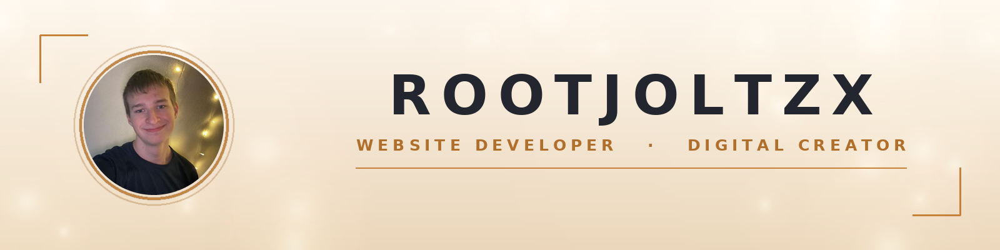

-  17-year-old full-stack web developer
-  Passionate about building modern web applications
-  Always learning new technologies and improving my skills
-  Interested in AI, open source, and software development
-  Open to collaboration and new opportunities

-  Full-Stack Development
-  Web Application Development
-  Open Source
-  Artificial Intelligence
-  UI/UX Design
-  Cloud Computing

 
 

 
 

**Languages:** JavaScript &nbsp;&middot;&nbsp; Python &nbsp;&middot;&nbsp; C++

**Frontend & Backend:** HTML5 &nbsp;&middot;&nbsp; Node.js &nbsp;&middot;&nbsp; Express.js

**Database:** MongoDB &nbsp;&middot;&nbsp; SQLite

[YouTube](https://www.youtube.com/@RootJoltzX) &nbsp;&middot;&nbsp; [Email](mailto:william.h61909@gmail.com) &nbsp;&middot;&nbsp; [Website](https://william.pink/)

